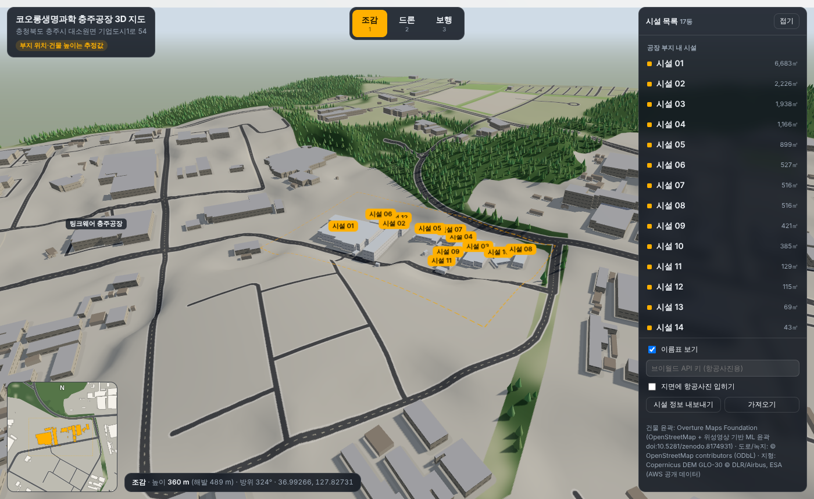

# 코오롱생명과학 충주공장 3D 지도

오픈 데이터로 만든 공장 주변 3D 지도입니다. **드론으로 날거나**, **사람 눈높이로 걸으면서** 시설을 둘러볼 수 있습니다. 서버 없이 도는 정적 웹앱이고 휴대폰(터치 조이스틱)에서도 됩니다.



## 실행

```bash
cd chungju-plant-3d
npm install
npm run dev      # http://localhost:5173
npm run build    # dist/ 에 정적 사이트 생성
```

## 조작

| 보기 | 키보드·마우스 | 터치 |
|---|---|---|
| 조감 `1` | 끌어서 회전, 휠 확대, 오른쪽 끌기 이동 | 한 손가락 회전, 두 손가락 확대·이동 |
| 드론 `2` | `WASD` 이동, `E`/`Q` 상승·하강, `Shift` 빠르게, 끌어서 둘러보기, `F` 마우스 고정 | 왼쪽 조이스틱 이동, 화면 끌어 둘러보기, ▲▼ |
| 보행 `3` | `WASD` 걷기, `Shift` 달리기 (건물은 통과 못 함, 지형을 따라 걸음) | 위와 같음 |

- 건물을 누르면 **이름·용도·높이·메모**를 고칠 수 있습니다. 브라우저에 저장되고, `시설 정보 내보내기`로 받은 `facilities.json`을 `public/data/`에 넣어 커밋하면 모두에게 적용됩니다.
- 시설 목록에서 고르면 그 시설 앞으로 이동합니다. 미니맵을 누르면 그 지점으로 갑니다.

## 지금 데이터의 한계 (꼭 읽어 주세요)

| 항목 | 출처 | 상태 |
|---|---|---|
| 공장 위치 | 회사 공개 주소(기업도시1로 54) | **부지 범위는 추정**입니다. 주소 번호와 건물 배치로 기업도시1로 남서쪽 건물군을 골랐고, 지도에서 직접 확인하지는 못했습니다. `site.config.json`의 `origin`, `siteBounds`를 고치고 `npm run data`를 다시 돌리면 바뀝니다. 앱에서 건물별로 "부지 내 시설" 체크를 바꿀 수도 있습니다. |
| 건물 윤곽 | Overture Maps (OpenStreetMap + 위성영상 자동 추출) | 실제 윤곽이지만 자동 추출분은 모서리가 다소 부정확합니다. |
| 건물 높이 | 없음 | **면적으로 어림한 값**입니다. 앱에서 건물마다 고칠 수 있습니다. |
| 시설 이름 | 없음 | `시설 01`… 은 면적순 임시 이름입니다. |
| 도로·녹지 | OpenStreetMap | 공장 내부 도로는 거의 없습니다. |
| 지형 | Copernicus DEM 30m (2011~2015 측량) | 30m 해상도라 공단의 계단식 평탄면·옹벽이 드러나지 않습니다. 개발지는 둔덕을 깎아 평탄화하고, 붙은 건물은 한 터로 묶어 같은 높이로 골랐습니다. 정확한 지형은 국토지리정보원 5m DEM이 필요합니다. |

## 데이터 다시 만들기

```bash
pip install -r scripts/requirements.txt
npm run data                 # public/data/scene.json 생성 (.cache/ 에 원본 보관)
python3 scripts/build_data.py --refresh   # 원본도 새로 받기
```

### 브이월드로 보강

1. **항공사진**: 앱 설정에 브이월드 API 키를 넣거나, `chungju-plant-3d/.env.local` 파일에 `VITE_VWORLD_KEY=키` 한 줄을 적고(커밋 금지, git이 무시함) `지면에 항공사진 입히기`를 켭니다. 브이월드에서 키의 서비스 URL에 앱 주소(`http://localhost:5173` 등)를 등록해야 합니다.
2. **건물 이름·층수**: `VWORLD_KEY=키 VWORLD_DOMAIN=등록URL python3 scripts/import_vworld.py` 후 `npm run data`.

브이월드는 해외 IP 접속을 막아 해외 클라우드에서는 쓸 수 없고, 한국 PC에서 실행해야 합니다. 두 기능 모두 작성 환경이 해외라 **실제 호출로 검증하지 못했습니다.** 처음 쓸 때 확인이 필요합니다.

## 실사 고도화 순서

1. 브이월드 항공사진을 지면에 입힘 (위 1번, 이미 구현).
2. 건물 높이·이름을 현장 자료로 보정 (`facilities.json`).
3. 드론 촬영 → 사진측량(WebODM, RealityCapture 등) → glTF/GLB로 내보내 `public/models/`에 두고 `public/data/overlays.json`에 등록:
   ```json
   [{ "url": "./models/plant.glb", "lat": 36.9968, "lon": 127.8236, "headingDeg": 0, "scale": 1, "altOffsetM": 0, "hideBuildingIds": ["..."] }]
   ```
   모델이 좌표에 맞춰 얹히고, 대체되는 상자 건물은 숨겨집니다.
4. 모델이 커지면 3D Tiles(`3d-tiles-renderer`)나 가우시안 스플랫으로 바꿔 스트리밍합니다. 좌표계(원점 기준 동·북 미터)는 그대로 씁니다.

공장 내부 촬영·공개는 회사 보안 규정과 드론 비행 승인 대상일 수 있으니 먼저 확인하세요.

## 구조

```
site.config.json        위치·범위 설정
scripts/build_data.py   오픈 데이터 → public/data/scene.json
scripts/import_vworld.py 브이월드 건물 이름·층수 받기
src/ground.ts           지형 높이, 지면 그림(도로·녹지·항공사진)
src/world.ts            건물·나무·하늘·조명, 실사 모델 얹기
src/controls.ts         조감·드론·보행 조작
src/main.ts             UI (시설 목록, 편집, 미니맵)
```

## 구글 실사 3D(Photorealistic 3D Tiles)를 쓰지 않은 이유

- 한국은 지도 데이터 국외 반출 제한 때문에 구글 3D 실사 지도가 제공되지 않는 지역으로 알고 있습니다. 쓰려면 Google Cloud Map Tiles API 키(결제 등록 필요)로 이 좌표를 직접 시험해 봐야 합니다.
- 제공되더라도 약관상 내려받아 저장하거나 고칠 수 없고, 스트리밍으로만 보여 줘야 합니다.
- 국내에서 쓸 수 있는 실사 자료는 **브이월드 항공사진·3D 건물**(키 필요), 그리고 **직접 드론 촬영한 사진측량 모델**입니다.

데이터 저작권: 건물 © Overture Maps Foundation · © OpenStreetMap contributors (ODbL), 지형 Copernicus DEM GLO-30 © DLR e.V. 2010-2014 and © Airbus Defence and Space GmbH 2014-2018, provided under COPERNICUS by the European Union and ESA.
